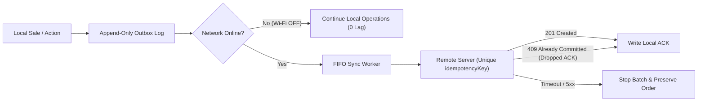

# local-first-outbox-sync

 
[](LICENSE)

Zero-dependency local-first transactional outbox queue and idempotent reconnect sync engine designed for retail counters, mobile field apps, and unstable 4G/Wi-Fi environments.

## The problem it solves

Cloud-only point-of-sale and COD checkout apps fail in two ways when a connection drops:

1. **Blocked writes:** The register freezes at peak hour while waiting on a remote HTTP response.
2. **Duplicate writes on retry:** A request succeeds on the server, the ACK drops on shaky 4G, and the client retries the same ticket twice, double-charging inventory or shipping two orders.

This engine persists every local write to an `fsync`-flushed append-only journal with a key-order-canonical SHA-256 `idempotencyKey`, truncates trailing torn writes on boot after abrupt power loss, enforces a single-flight sync mutex, quarantines permanent `400`/`422` errors to a dead-letter queue so valid sales never head-of-line block, and reconciles explicit `409 { duplicate: true }` responses cleanly when connectivity returns.

## Architecture



## Quick Start

```bash
git clone https://github.com/JARMID/local-first-outbox-sync.git
cd local-first-outbox-sync
npm test
```

## License

MIT © [Khalef Abdelmadjid (@JARMID)](https://github.com/JARMID)
